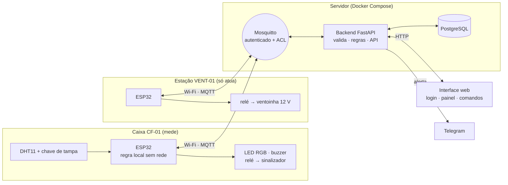
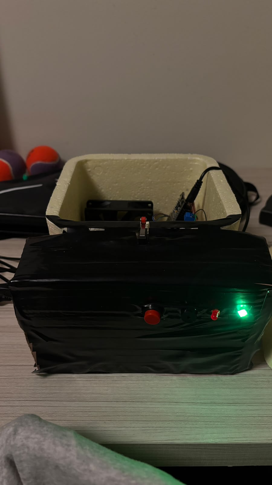
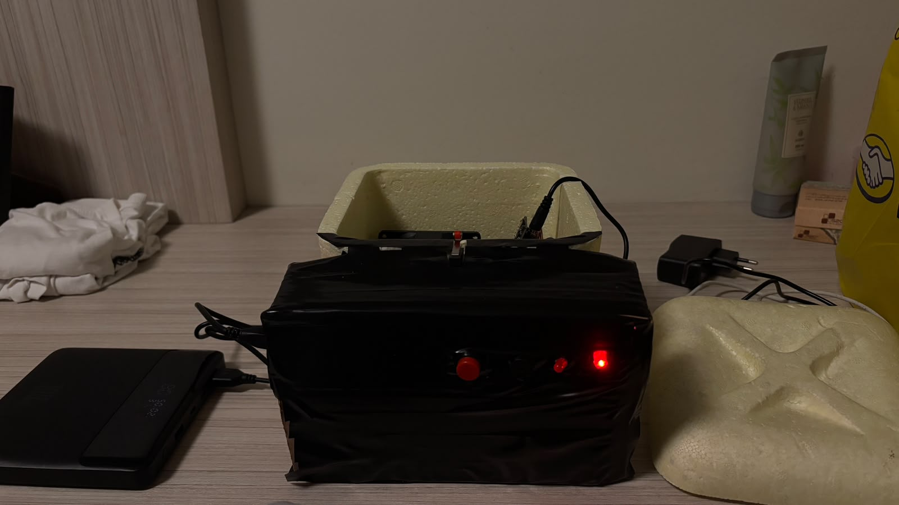
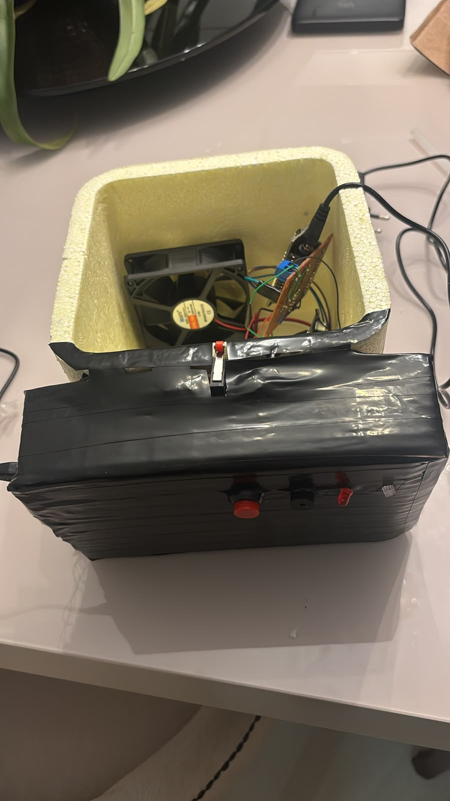

# Sentinela de Cadeia Fria

[](https://github.com/VictorKunzz/sentinela-cadeia-fria/actions/workflows/ci.yml)


Monitor de campo que mede **quanto tempo e sob que calor** um produto refrigerado ficou exposto durante o manuseio, o trecho da cadeia fria em que hoje ninguém mede nada, e **transmite isso em tempo real** para a coordenação, que pode **agir à distância**.

> Projeto da disciplina **Internet das Coisas** (6º semestre, Católica SC), Prof. Edson Vaz Lopes. Família temática: **Temperatura e Cadeia Fria**.

## Sumário

- [O problema](#o-problema)
- [Como funciona](#como-funciona)
- [Funcionalidades](#funcionalidades)
- [O sistema montado](#o-sistema-montado)
- [Início rápido](#início-rápido)
- [Usando o sistema](#usando-o-sistema)
- [Estrutura do repositório](#estrutura-do-repositório)
- [Testes e CI](#testes-e-ci)
- [Requisitos do piso (R1 a R18)](#requisitos-do-piso-r1-a-r18)
- [Limitações e o que mudou do planejado](#limitações-e-o-que-mudou-do-planejado)
- [Documentação](#documentação)
- [Equipe](#equipe)

## O problema

A cadeia fria é vigiada nas pontas e cega no meio. A geladeira da unidade tem termômetro; o caminhão refrigerado também. Entre um e outro, a caixa térmica fica aberta na calçada, na bancada, ao sol, e ninguém registra. Quando um lote é descartado por suspeita, não há como saber **se falhou o equipamento ou o manuseio**; o relato disponível é *"acho que ficou uns cinco minutos aberto"*.

O usuário principal é o **técnico de enfermagem em campanha de vacinação extramuros**, que abre a tampa dezenas de vezes por turno. O usuário secundário é a **coordenação da unidade**, que acompanha e decide à distância.

## Como funciona

Dois dispositivos ESP32 conversam por MQTT com um backend. **Os dispositivos nunca se falam**: a caixa mede e publica; o backend decide e é o **único que publica comandos**; a estação de ventilação só atua. A interface web fala apenas com a API, nunca com o broker.



**A caixa (`CF-01`)** tem uma máquina de estados local que funciona **sem rede**: `FECHADO → EXPOSTO → QUEBRA`. Com a tampa aberta, um **orçamento de exposição** é drenado mais rápido quanto mais quente estiver o ambiente; ao esgotar, a caixa entra em QUEBRA, acende o semáforo vermelho e dispara o alarme sonoro. Detalhes e a limitação dessa fórmula: [`docs/orcamento-termico.md`](docs/orcamento-termico.md).

**O backend** aplica duas regras e todo comando segue um ciclo com confirmação:

- **Ventilação (R8):** se a caixa medir **mais de 30 °C por 2 minutos**, liga a ventoinha da `VENT-01`; desliga **abaixo de 26 °C** (histerese). Os limites são editáveis.
- **QUEBRA:** liga o sinalizador de retenção da caixa e avisa a coordenação pelo Telegram.
- **Ciclo de comando:** `enviado → recebido → executado → confirmado`, ou `rejeitado` (com motivo), `nao_confirmado` (sem resposta no prazo) e `sem_efeito` ("já estava assim"). Cada comando tem um `commandId`; repetido, é rejeitado sem executar.

## Funcionalidades

- **Dois dispositivos** com papéis diferentes, cada um com `deviceId` próprio (`CF-01` e `VENT-01`).
- **Contrato MQTT versionado** ([`CONTRATOS.md`](CONTRATOS.md), `version: 1`): tópicos por dispositivo, unidades, `commandId`, catálogo de erros, QoS e retenção justificados.
- **Modos de operação** em cada dispositivo: automático, manual (volta sozinho em 10 min) e seguro (falha de sensor ou perda prolongada de contato).
- **Interface web** com login e dois perfis: o **técnico** só visualiza; a **coordenação** visualiza e comanda. Painel por dispositivo, alertas, histórico com média móvel e lacunas visíveis, indicadores (tempo em exposição, aberturas, tempo em QUEBRA) e edição das regras.
- **Notificação no Telegram** em QUEBRA e quando um dispositivo fica offline (opcional: precisa de um bot próprio).
- **Presença** por *Last Will* (online/offline e último contato).
- **OTA** (*over-the-air*): atualização do firmware pelo Wi-Fi, sem cabo, com senha. Implementado; ver as limitações abaixo.
- **Mensagens inválidas** são descartadas e registradas (`mensagens_rejeitadas`), nunca gravadas.
- **Orquestração** com Docker Compose; **testes automatizados** e CI no GitHub Actions.

## O sistema montado

O sistema entregue foi montado assim:

- **Caixa térmica:** um cooler (caixa de isopor), que abriga os dois dispositivos. Os componentes da `CF-01` foram fixados em um **pedaço de papelão** que fica **do lado de fora**: os LEDs aparecem por furos no papelão e os fios ficam por trás. A **chave de tampa** fica na borda, para ser pressionada ao fechar, e só o **DHT11 fica pendurado para dentro do cooler**. A eletrônica da `CF-01` está soldada numa placa perfurada, com o ESP32 num soquete.
- **VENT-01:** placa perfurada soldada (ESP32 em soquete, relé ligado por jumpers, bornes para a alimentação), colocada **dentro do cooler** junto com a ventoinha, com um pequeno recorte na borda por onde sai o cabo da fonte de **12 V** (uma tomada só). A ideia é usar a ventilação para ajudar a resfriar o interior.
- **Alimentação:** a `CF-01` por power bank (USB), com teste de autonomia de 30 minutos concluído sem problemas; a `VENT-01` por fonte 12 V, com um regulador LM2596 ajustado em 5,0 V para o ESP32. O ESP32 nunca alimenta a ventoinha: ela só recebe 12 V pelo contato do relé.

<p align="center">
  
  
  
</p>

Mais fotos e um vídeo, em [`docs/img/`](docs/img/):

| Arquivo | O que mostra |
|---|---|
| [`04-caixa-de-papelao-antes-da-fita.jpeg`](docs/img/04-caixa-de-papelao-antes-da-fita.jpeg) | o papelão da `CF-01` antes de ser forrado com fita: botão de reset, buzzer e LEDs pelos furos |
| [`05`](docs/img/05-interior-vista-superior-1.jpeg) e [`06`](docs/img/06-interior-vista-superior-2.jpeg) | interior do cooler visto de cima: `VENT-01`, ventoinha, DHT11 e chave de tampa |
| [`07-chave-de-tampa-na-borda.jpeg`](docs/img/07-chave-de-tampa-na-borda.jpeg) | microchave KW12 encaixada na borda do isopor |
| [`08`](docs/img/08-solda-placa-perfurada-1.jpeg), [`09`](docs/img/09-solda-placa-perfurada-2.jpeg) e [`10`](docs/img/10-solda-placa-perfurada-3.jpeg) | lado da solda das placas perfuradas |
| [`11-esp32-na-placa-perfurada-vazia.jpeg`](docs/img/11-esp32-na-placa-perfurada-vazia.jpeg) | ESP32 posicionado na placa perfurada (5 × 7 cm) antes de soldar |
| [`12-prototipo-na-protoboard.jpeg`](docs/img/12-prototipo-na-protoboard.jpeg) e [`13-bancada-de-montagem.jpeg`](docs/img/13-bancada-de-montagem.jpeg) | protótipo na protoboard e bancada de montagem |
| [`14-componentes-comprados.jpeg`](docs/img/14-componentes-comprados.jpeg) | componentes da compra da N3 |
| [`15-video-sistema.mp4`](docs/img/15-video-sistema.mp4) | vídeo do sistema montado |

### Componentes

| Dispositivo | Componente | Função |
|---|---|---|
| `CF-01` | ESP32 DevKit V1 (30 pinos) | controlador e Wi-Fi |
| `CF-01` | Sensor DHT11 | temperatura e umidade do **ambiente de exposição** (não do produto) |
| `CF-01` | Microchave fim de curso KW12 | sensor de tampa |
| `CF-01` | Botão de painel PBS-11B | reset local da QUEBRA |
| `CF-01` | LED RGB (cátodo comum) | semáforo de estado |
| `CF-01` | Buzzer ativo | alarme sonoro, também comandável |
| `CF-01` | Módulo relé 2 canais (1 usado) + LED vermelho com resistor | sinalizador de retenção |
| `VENT-01` | ESP32 DevKit V1 (30 pinos) | controlador e Wi-Fi |
| `VENT-01` | Módulo relé 1 canal SRD-05VDC | liga e desliga a ventoinha |
| `VENT-01` | Ventoinha 80 mm, 12 V, 0,15 A | exaustor |
| `VENT-01` | Fonte 12 V 1 A + conector P4 + LM2596 | alimentação em uma tomada |

Pinos e ligações: [`docs/n3/PINAGEM.md`](docs/n3/PINAGEM.md). Lista de compra: [`docs/n3/BOM.md`](docs/n3/BOM.md). Registro de montagem das placas: [`docs/n3/montagem/`](docs/n3/montagem/).

## Início rápido

### Pré-requisitos

- **Docker** com Docker Compose
- **PlatformIO** (extensão do VS Code ou CLI) para compilar e gravar os firmwares
- Duas placas **ESP32 DevKit V1** e cabo USB **de dados**; driver **CP210x** no Windows
- Rede Wi-Fi de **2,4 GHz** (o ESP32 não usa 5 GHz nem redes com login corporativo)

> Não tem as placas? O [simulador](#sem-hardware) faz o papel das duas caixas.

### 1. Clonar e configurar o servidor

```bash
git clone https://github.com/VictorKunzz/sentinela-cadeia-fria.git
cd sentinela-cadeia-fria
cp .env.example .env
```

Edite o `.env` e **troque todas as senhas** (banco, Mosquitto, JWT e usuários da interface). Principais variáveis:

| Variável | Para quê |
|---|---|
| `POSTGRES_PASSWORD` | senha do banco |
| `MQTT_PASS_BACKEND`, `MQTT_PASS_CF01`, `MQTT_PASS_VENT01` | senha de cada cliente no Mosquitto (usuário = `deviceId`) |
| `JWT_SECRET` | assinatura dos tokens de login |
| `SEED_COORDENACAO_*`, `SEED_TECNICO_*` | usuários e senhas do painel |
| `TELEGRAM_BOT_TOKEN`, `TELEGRAM_CHAT_ID` | opcionais; vazios desligam o Telegram |

### 2. Subir os serviços

```bash
docker compose up -d --build
```

Sobem **Mosquitto** (porta 1883, autenticado, com ACL por dispositivo), **PostgreSQL** e o **backend**. As migrações rodam sozinhas. Depois:

- Painel: <http://localhost:8000/>
- Documentação interativa da API: <http://localhost:8000/docs>

Para os ESP32 alcançarem o broker, libere a **porta 1883** no firewall do computador e use o **IP do computador na rede** (nunca `localhost`).

### 3. Gravar os firmwares

```bash
cp firmware/include/secrets.example.h firmware/include/secrets.h
```

Preencha o `secrets.h` (não é versionado): Wi-Fi, `MQTT_HOST` (IP do computador), as senhas `MQTT_PASSWORD_CF01` e `MQTT_PASSWORD_VENT01` (iguais às do `.env`) e `OTA_PASSWORD`. Os dois firmwares usam o mesmo arquivo. Depois, na pasta `firmware/`:

```bash
pio run -e esp32dev -t upload     # CF-01 (caixa)
pio run -e vent01 -t upload       # VENT-01 (estação de ventilação)
pio device monitor -b 115200      # acompanhar o Serial
```

Se o comando `pio` não for reconhecido no Windows, use o terminal do PlatformIO no VS Code (ou o caminho `%USERPROFILE%\.platformio\penv\Scripts\pio.exe`). Com o Mosquitto na rede local, vale descomentar `MQTT_KEEPALIVE_S 15` no `secrets.h` (o padrão de 60 s foi escolhido para hotspot e broker público, e faz o `offline` demorar ~90 s para aparecer). Há ainda programas de teste de bancada, sem rede: `pio run -e cf01_teste -t upload` e `pio run -e vent01_teste -t upload`.

Esperado no Serial: conexão Wi-Fi, `MQTT: conectado. status=online`, e os dois dispositivos aparecendo **online** no painel. Para atualizar sem cabo (OTA), use `pio run -e cf01_ota -t upload` ou `-e vent01_ota`, com a variável de ambiente `OTA_PASSWORD` definida.

### Sem hardware

(`firmware/wokwi.toml` e `diagram.json` descrevem só a CF-01 da N1, no simulador Wokwi, sem DHT11; não há diagrama da VENT-01.)

Com os serviços no ar, o simulador publica telemetria e responde comandos como as duas caixas:

```bash
docker compose run --rm --no-deps -v "$PWD/simulador:/sim:ro" backend python /sim/simulador.py --host mosquitto --velocidade 20
```

## Usando o sistema

1. Abra o painel e entre com um dos usuários do `.env`. O perfil **coordenação** vê os botões de comando; o **técnico** só visualiza.
2. Cada cartão mostra um dispositivo: presença, temperatura e umidade com unidade, estado, modo, orçamento e atuadores.
3. Envie um comando (ex.: ligar a ventoinha da `VENT-01`) e acompanhe o status ao vivo: aguardando, executado, confirmado, "já estava assim", "não confirmado" ou "recusado: motivo".
4. Em **Histórico**, escolha o período: o gráfico mostra a temperatura com média móvel, e **períodos sem dados aparecem como lacuna**.
5. Em **Regras**, a coordenação ajusta os limites de 30 °C, 26 °C e da janela de 2 minutos.
6. Para o **Telegram**, crie um bot com o @BotFather e preencha o token e o `chat_id` no `.env`; o passo a passo está em [`backend/README.md`](backend/README.md).

Demonstração típica: aqueça o DHT11 (mão ou secador) acima de 30 °C por 2 minutos e a ventoinha liga sozinha, com o comando confirmado no painel. Abra a tampa até esgotar o orçamento e a caixa entra em QUEBRA: semáforo vermelho, alarme, sinalizador aceso pelo backend e aviso no Telegram.

## Estrutura do repositório

```
.
├── CONTRATOS.md          contrato MQTT v1
├── compose.yaml          Mosquitto + PostgreSQL + backend
├── .env.example          variáveis do servidor (copie para .env)
├── mosquitto/            configuração e ACL do broker
├── backend/              FastAPI, SQLAlchemy, Alembic, interface web (app/static), testes
├── firmware/             PlatformIO: CF-01, VENT-01, OTA, programas de teste de bancada e testes de lógica
├── simulador/            simulador das duas caixas, pelo contrato
├── .github/workflows/    CI (pytest, compose, build do firmware)
└── docs/                 arquitetura, testes, pesquisa do orçamento e documentos da N3
```

## Testes e CI

A cada push e pull request, o GitHub Actions executa:

- **backend:** `pytest` em Python 3.12 (validação do contrato, histerese da regra, `commandId` duplicado, perfis, ciclo de comando, Telegram, simulador contra o backend);
- **compose:** validação do `compose.yaml`;
- **firmware:** build de `esp32dev` e `vent01` e testes de lógica pura (`pio test -e native`).

Localmente:

```bash
docker run --rm -v "$PWD:/repo" -w /repo/backend python:3.12-slim sh -c "pip install -q -r requirements-dev.txt && python -m pytest -q"
```

O registro dos testes feitos em bancada e dos cenários de falha está em [`docs/testes.md`](docs/testes.md).

## Requisitos do piso (R1 a R18)

| Req. | Tema | Onde está |
|---|---|---|
| R1 | Hardware: entradas e atuadores reais | DHT11 e chave de tampa; relé, buzzer, LED, ventoinha 12 V ([`PINAGEM.md`](docs/n3/PINAGEM.md)) |
| R2 | Firmware | `firmware/` (máquina de estados, NVS, modos, estado seguro) |
| R3 | Contrato MQTT | [`CONTRATOS.md`](CONTRATOS.md) |
| R4 | Backend | `backend/app` ([`API.md`](backend/API.md)) |
| R5 | Banco | PostgreSQL com migrações Alembic (`backend/alembic`) |
| R6 | Interface | `backend/app/static` |
| R7 | Ciclo de comando | `backend/app/comandos.py` |
| R8 | Decisão remota | `backend/app/regras.py` |
| R9 | Segurança básica | login com JWT e bcrypt; segredos fora do Git |
| R10 | Falhas testadas | [`docs/testes.md`](docs/testes.md) |
| R11 | Entrega executável | este README, `.env.example`, `compose.yaml` |
| R12 | Docker Compose | `compose.yaml` |
| R13 | Múltiplos dispositivos | `CF-01` e `VENT-01` |
| R14 | Painel analítico | histórico com média móvel e indicadores |
| R15 | Notificação externa | Telegram (`backend/app/telegram.py`); testado com stub, sem bot real |
| R16 | Perfis | técnico e coordenação |
| R17 | OTA | ArduinoOTA com senha (implementado; sem demonstração em hardware) |
| R18 | Testes e CI | pytest, testes nativos, GitHub Actions |

## Limitações e o que mudou do planejado

Registradas abertamente: são escolhas conscientes, não esquecimentos.

**Diferenças em relação ao esquema do CP12 (proposta de upgrade):**

- **Buzzer ligado direto ao GPIO**, sem o transistor BC337 do esquema; **ventoinha sem o diodo 1N4007** de roda livre. As duas peças não foram obtidas a tempo.
- **Sem ESP32 nem DHT11 reserva**, como o CP12 previa.
- **Sem molde 3D**: a `CF-01` ficou fixada em papelão dentro do cooler, em vez de uma peça impressa.
- **Módulo de potência**: a ventoinha é acionada por relé de 1 canal, e não por MOSFET.
- **Relé da VENT-01 em open-drain simulado**: o módulo é ativo-baixo e não solta com HIGH de 3,3 V, então o firmware liga com saída em LOW e desliga com o pino como entrada.
- Os termos "exaustor" e "módulo de potência" do CP12 correspondem, na prática, à ventoinha de 80 mm e ao módulo relé.

**Limitações do sistema montado:**

- **A ventoinha não resfria de verdade o cooler.** Ela fica dentro da caixa e não há saída para o ar quente, então o interior tende a esquentar. A ventilação demonstra a **decisão remota** (backend → comando → atuador, com confirmação), mas não é uma solução térmica eficaz.
- **A ventoinha pode ligar com a tampa fechada.** A regra R8 decide só pela temperatura medida; o ideal seria atuar apenas com a tampa aberta. Não foi feito por custo e prazo.
- **OTA** está implementado no firmware, mas **não foi demonstrado nem testado em hardware**; a gravação foi feita por cabo USB.
- **Telegram:** o envio é coberto por testes automatizados, mas **nenhum bot real foi criado**, então não houve teste contra a API do Telegram.
- **DHT11 sem calibração:** não houve comparação com termômetro de referência.

**Limitações técnicas:**

- O **DHT11 mede o ar**, não o produto (±2 °C, 1 °C de resolução, 0 a 50 °C). Bafo e vapor saturam a umidade; nesse caso só a umidade é invalidada.
- O **orçamento de exposição** (`consumo/s = 1 + (T − 20)/10`, 120 unidades) é um **indicador didático**: não tem respaldo normativo implementado. A pesquisa de bases e modelos alternativos está em [`docs/orcamento-termico.md`](docs/orcamento-termico.md) e fica como trabalho futuro.
- As publicações dos dispositivos saem em **QoS 0** (limitação da biblioteca PubSubClient). A perda de uma confirmação aparece como `nao_confirmado`, nunca como falha silenciosa.
- **Sem buffer offline:** durante uma queda de rede a regra local continua, mas a telemetria desse intervalo não é guardada.
- O gráfico do painel usa **Chart.js por CDN** (precisa de internet).
- O Telegram avisa QUEBRA e queda de dispositivo, mas **não avisa quando ele volta**.
- O sinalizador de retenção é um LED; em uso real seria uma torre de sinalização (contato seco, sem mudar o circuito de controle).

## Trabalho futuro

- **Cortina de ar na borda da tampa**, como nas lojas com portas refrigeradas abertas: faixas de ar na abertura impedem que o ar externo entre e o interno saia. É uma proposta de maior impacto real do que ventilar dentro da caixa, e abre espaço para um estudo térmico. Exige ventoinha na borda, com saída de ar, e atuação **apenas com a tampa aberta** (a chave de tampa já existe; a regra no backend precisaria considerar o estado da tampa).
- **Orçamento de exposição com base normativa** e perfis calibrados (ver [`docs/orcamento-termico.md`](docs/orcamento-termico.md)).
- **Validar o DHT11** contra um termômetro de referência e medir o tempo de resposta ([`docs/risco-01-dht11.md`](docs/risco-01-dht11.md)).
- **Buffer offline** de telemetria, publicações em QoS 1 (trocando a biblioteca MQTT) e aviso de retorno online no Telegram.
- Sinalizador de retenção como torre de sinalização, molde 3D da caixa e demonstração do OTA.

## Documentação

| Documento | Conteúdo |
|---|---|
| [`CONTRATOS.md`](CONTRATOS.md) | contrato MQTT v1: tópicos, payloads, comandos, erros, QoS |
| [`backend/API.md`](backend/API.md) | formatos da API REST |
| [`backend/README.md`](backend/README.md) | testes, simulador, migrações, Telegram, CI |
| [`docs/n3/PINAGEM.md`](docs/n3/PINAGEM.md) | pinos e ligações dos dois dispositivos |
| [`docs/n3/BOM.md`](docs/n3/BOM.md) | lista de materiais |
| [`docs/n3/montagem/`](docs/n3/montagem/) | registro de montagem das placas soldadas |
| [`docs/n3/CP12.md`](docs/n3/CP12.md) | proposta de upgrade (CP12), seções 1 a 4; o PDF completo está em [`docs/n3/`](docs/n3/) |
| [`docs/testes.md`](docs/testes.md) | testes executados, com saídas capturadas |
| [`docs/orcamento-termico.md`](docs/orcamento-termico.md) | base técnica e opções para o orçamento de exposição |
| [`docs/risco-01-dht11.md`](docs/risco-01-dht11.md) | risco técnico do DHT11 |
| [`docs/arquitetura-inicial.md`](docs/arquitetura-inicial.md), [`docs/arquitetura-mqtt.md`](docs/arquitetura-mqtt.md), [`docs/prototipo.md`](docs/prototipo.md) | histórico do protótipo da N1 |

## Equipe

| Integrante | GitHub |
|---|---|
| Victor Henrique Kunz de Souza | [@victorkunzz](https://github.com/victorkunzz) |
| Henrique Cordeiro de Oliveira | [@rique1011](https://github.com/rique1011) |
| Nicholas Scoz dos Santos | [@nicholasscoz](https://github.com/nicholasscoz) |
| Lucas Rogério Mendonça | [@mendoncaluucas](https://github.com/mendoncaluucas) |
| Kauã Henrique Lucindo | [@lucind0](https://github.com/lucind0) |
| Vinicius Steuernagel | [@steuer10](https://github.com/steuer10) |
