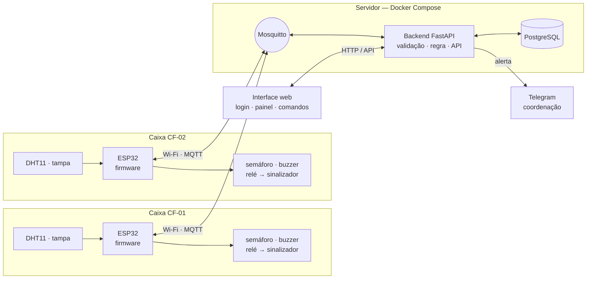
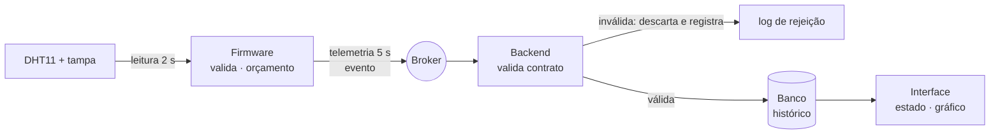
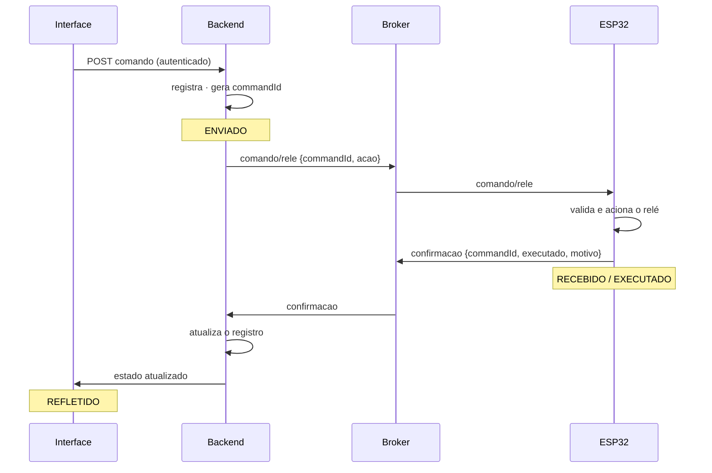

# CP12 — Proposta de upgrade do projeto N1

**Internet das Coisas · Aula 12 — Hardware, firmware-base e contratos** · Prof. Edson Vaz Lopes

| | |
|---|---|
| **Projeto (N1 → N3)** | Sentinela de Cadeia Fria → Sentinela de Cadeia Fria, produto conectado |
| **Equipe** | Equipe 6 — Sentinela de Cadeia Fria |
| **Integrantes** | Victor Henrique Kunz de Souza · Henrique Cordeiro de Oliveira · Nicholas Scoz dos Santos · Lucas Rogério Mendonça · Kauã Henrique Lucindo · Vinicius Steuernagel |
| **Data / Versão** | 20/10/2026 · v1.0 (entrega parcial: seções 1 a 4) |
| **Repositório** | github.com/VictorKunzz/sentinela-cadeia-fria |

---

## 1. Ponto de partida: o projeto da N1

### Problema e usuário

A cadeia fria é vigiada nas pontas e cega no meio. A geladeira da unidade tem termômetro; o caminhão refrigerado tem termômetro. Entre os dois existe um intervalo sem instrumentação nenhuma: a caixa térmica aberta na calçada, o produto na bancada, a bolsa ao sol porque apareceu fila. Quando um lote é descartado por suspeita, não há como saber se falhou o equipamento ou o manuseio — e, sem saber, não há o que corrigir.

- **Usuário principal:** o técnico de enfermagem em campanha de vacinação extramuros, que abre a tampa dezenas de vezes por turno, sob mais de 30 °C, e preenche o registro de temperatura de memória no fim do dia.
- **Usuário secundário:** a coordenação da unidade, que hoje só lê um relatório posterior e passa a acompanhar e agir em tempo real.

### O que funcionou na N1

- **Checklist de enquadramento IoT 7/7**, verificado em hardware real.
- **Firmware não-bloqueante** (sem `delay()` no laço), com máquina de estados `FECHADO → EXPOSTO → QUEBRA`, debounce das chaves e um **orçamento térmico** que drena mais rápido quanto mais quente está o ambiente.
- **Leitura real do DHT11** alimentando o orçamento — a drenagem observada bateu com o modelo nos três patamares medidos (31,8 °C, 25,3 °C e 24,8 °C).
- **Camada MQTT completa:** telemetria a cada 5 s, eventos discretos, presença retida com *Last Will*, comandos remotos com confirmação que distingue recebido de executado — inclusive recusando com motivo um `reset` fora de quebra.
- **Reconexão automática** ao Wi-Fi e ao broker, refazendo as assinaturas.
- **Documentação e testes registrados** no repositório (`docs/arquitetura-mqtt.md`, `docs/testes.md`).

### Limitações conhecidas

- **Não há backend, banco nem interface.** O "painel da coordenação" foi um cliente MQTT genérico operado manualmente; nada é persistido além do broker.
- **A decisão é humana.** Ninguém liga o sinalizador de retenção sem uma pessoa olhando o terminal.
- **Relé sob carga não validado:** alimentar o módulo pelo pino de 3,3 V derruba a tensão e dispara o *brownout* do ESP32. Correção conhecida: alimentar pelo `VIN`.
- **Publicações em QoS 0** (limitação do PubSubClient) e **sem buffer offline** — a telemetria produzida durante uma queda de rede é perdida.
- **Sem relógio real:** o `ts` é tempo desde o boot e zera a cada reinício.
- **Configuração fixa no código-fonte** — mudar o orçamento exige regravar a placa.
- **Broker sem autenticação** e um único dispositivo.
- **O orçamento térmico é uma heurística da equipe**, declarada como tal, sem referência externa.

### Proposta de valor

> **O Sentinela transforma "acho que ficou uns cinco minutos aberto" em "abertura nº 3, 46 segundos, média de 24,8 °C".**

Para a coordenação de uma unidade de saúde, é a diferença entre descartar um lote por desconfiança e decidir com dado. O produto:

- **mede o trecho que ninguém mede** — o manuseio, entre a geladeira e o caminhão;
- **alerta enquanto acontece**, na própria caixa e no celular da coordenação, em vez de virar uma anotação no fim do dia;
- **marca o lote suspeito para retenção automaticamente**, sem depender de alguém estar olhando;
- **guarda o histórico de cada caixa**, para descobrir se o problema é um equipamento, um turno ou um local.

A alternativa hoje é não ter nada: um termômetro que ninguém lê durante o atendimento e um registro preenchido de memória.

### Pedido de troca de projeto

☐ Sim  ☒ **Não** — o projeto da N1 comporta integralmente o upgrade. O problema e o usuário se mantêm; o que muda é a camada entre o dispositivo e a coordenação.

---

## 2. Upgrade por camada

| Camada | Como era na N1 | Como será na N3 |
|---|---|---|
| **Hardware** | Um ESP32 em protoboard: DHT11, chave de tampa, botão de reset, LED RGB, buzzer e módulo relé (este com *brownout* ao acionar). | **Duas caixas** (`CF-01` e `CF-02`), cada uma com o mesmo arranjo, montado em caixa térmica com fixação, sem fios soltos. Relé alimentado pelo `VIN` com GND comum. |
| **Firmware** | Laço não-bloqueante, máquina de estados, orçamento térmico, reconexão, logs. Configuração fixa no código. | Acrescenta **configuração persistente em NVS** (alterável por comando), **estado seguro** para falha de sensor, **identidade** por `deviceId`, indicação explícita de hora não sincronizada e **atualização OTA**. |
| **Comunicação (MQTT)** | Contrato em `docs/arquitetura-mqtt.md`, tópicos sem identificação de dispositivo, comandos sem identificador. | **`CONTRATOS.md` versionado**, com `deviceId` na árvore de tópicos, `version`, `timestamp` e unidades em cada payload, `commandId` em comando e confirmação, e catálogo de códigos de erro. |
| **Backend** | *(não existia)* | Serviço **FastAPI** que assina os tópicos, **valida** cada mensagem contra o contrato (descarta e registra as inválidas), persiste, expõe a API e é **o único componente que publica comandos**. |
| **Banco de dados** | *(não existia)* | **PostgreSQL** com histórico de medições, eventos e registro completo de comandos (`commandId`, origem, ação, envio, resultado, confirmação). Esquema versionado por migração. |
| **Interface** | *(não existia — papel exercido por um cliente MQTT genérico)* | **Aplicação web** com identidade visual própria: estado atual de cada caixa, histórico, último contato, online/offline, alertas ativos e envio de comando, com **login** e perfis de acesso. |
| **Decisão / regra** | Toda decisão era humana: uma pessoa via a quebra no terminal e publicava o comando. | **Regra no backend:** ao detectar uma caixa em QUEBRA, o backend liga o sinalizador de retenção daquela caixa e dispara a notificação, seguindo o mesmo ciclo de comando com confirmação. A regra local (semáforo e alarme) continua no firmware, funcionando sem rede. |

---

## 3. Conferência contra o piso R1–R18

| Req. | Como o projeto vai atender |
|---|---|
| **R1** Hardware | Duas entradas de tipos diferentes — **DHT11** (temperatura e umidade) e **chave de tampa** (abertura) — e atuadores reais: **relé** acionando o sinalizador de retenção, buzzer e LED de alerta. Relé por **módulo opto-isolado com diodo de roda livre**, alimentado pelo `VIN`; nenhuma carga ligada direto em GPIO. Mapa de pinos, BOM e esquema no repositório. *Já existe da N1; falta: corrigir a alimentação do relé e montar em caixa.* |
| **R2** Firmware | Já existem: leitura não-bloqueante com periodicidades definidas, validação (`isnan`, leitura inválida não substitui a última válida), **regra local que funciona sem rede** (máquina de estados, semáforo e alarme), reconexão ao Wi-Fi e ao broker **refazendo as assinaturas**, logs no Serial. **A acrescentar:** faixa plausível na validação; estado seguro para sensor ausente (orçamento congelado, LED azul, alerta publicado); **orçamento inicial persistido em NVS** e alterável por comando; `deviceId` próprio; campo indicando hora não sincronizada. |
| **R3** Contrato MQTT | Evolução do `docs/arquitetura-mqtt.md` para **`CONTRATOS.md`**, com árvore `sentinela/cadeia-fria/{deviceId}/...`, um payload de exemplo por tópico com `version`, `deviceId`, `timestamp` e unidades, lista de comandos e faixas, confirmação com `commandId` e resultado, catálogo de códigos de erro, e QoS/retain justificados por tópico. *v0 nesta entrega, v1 congelado em 27/10.* |
| **R4** Backend | **FastAPI (Python)** assinando os tópicos de todas as caixas, validando cada mensagem contra o contrato — inválidas são descartadas e registradas —, persistindo no banco e expondo API REST para estado atual, histórico e envio de comando. O backend é **o único que publica comandos**; a interface nunca fala direto com o broker. *Pendente: implementação na Unidade 3.* |
| **R5** Banco de dados | **PostgreSQL** com tabelas de medições (dispositivo, grandeza, valor, unidade, timestamp), eventos da máquina de estados e comandos (`commandId`, origem, ação, envio, resultado, confirmação). Esquema versionado por migração. *Pendente: modelo de dados detalhado em 27/10.* |
| **R6** Interface | **Aplicação web** com nome, cores e ícones do Sentinela, mostrando por caixa: temperatura e umidade com unidade, histórico em gráfico, horário do último contato, online/offline, alertas ativos e botões de comando. Um comando só aparece como executado **depois** da confirmação do dispositivo. *Pendente: esboço das telas em 27/10.* |
| **R7** Ciclo de comando | Quatro estados registrados por `commandId`: **enviado** (backend registrou), **recebido** (dispositivo aceitou ou rejeitou), **executado** (atuador agiu) e **refletido** (estado publicado e mostrado na interface). Rejeição traz motivo — a N1 já recusa `reset` fora de quebra; a N3 acrescenta o `commandId`. |
| **R8** Decisão remota | Regra no backend: **se uma caixa entra em QUEBRA, o backend liga o sinalizador de retenção daquela caixa e notifica a coordenação**. Usa o evento persistido e um parâmetro configurável pelo usuário (ligar automaticamente ou só alertar), e gera comando com o ciclo do R7. |
| **R9** Segurança básica | **Login com usuário e senha** na interface; rotas de comando da API exigem autenticação. Credenciais de Wi-Fi, broker, banco e aplicação em arquivos fora do Git (`secrets.h` e `.env`). *Já existe: `secrets.h` ignorado pelo Git desde a N1. Falta: autenticação.* |
| **R10** Falhas testadas | Quatro cenários, cada um com provocação, esperado, observado e evidência: **(1) queda do Wi-Fi** — regra local segue, presença vira `offline`, reconexão automática; **(2) broker indisponível** — backoff exponencial até 30 s; **(3) falha de sensor** — estado seguro; **(4) comando inválido ou duplicado** — rejeição com motivo, e `commandId` repetido não é executado duas vezes. *Já existe: `docs/testes.md` com parte das evidências.* |
| **R11** Entrega executável | README com pré-requisitos, `.env.example`, passos para subir os serviços e gravar o firmware; **tag de release** da versão defendida; commits de todos os integrantes. *Já existe: seção "Como executar" da N1. Falta: serviços e release.* |
| **R12** Orquestração | **`compose.yaml`** subindo Mosquitto, backend e PostgreSQL com um único `docker compose up`, variáveis sensíveis via `.env`. *Pendente.* |
| **R13** Múltiplos dispositivos | **Duas caixas físicas, `CF-01` e `CF-02`**, com o mesmo firmware e `deviceId` distintos. O contrato da N1 já previa o prefixo por dispositivo. Backend e interface distinguem as duas. *Pendente: segundo ESP32 e kit de componentes.* |
| **R14** Painel analítico | Gráfico de temperatura com **média móvel** e indicadores agregados por caixa: **tempo acumulado em exposição**, número de aberturas por turno e tempo em QUEBRA, a partir do histórico real. *Pendente: escolha entre gráfico na interface ou Grafana.* |
| **R15** Notificação externa | **Bot do Telegram** avisando a coordenação quando uma caixa entra em QUEBRA ou fica offline. *Pendente.* |
| **R16** Segurança avançada | **Perfis com permissões diferentes:** o *técnico* visualiza as caixas; a *coordenação* visualiza e comanda. Corresponde aos dois usuários do projeto. *Pendente.* |
| **R17** OTA | **ArduinoOTA** no firmware, com demonstração de atualização sem cabo durante a defesa. *Pendente.* |
| **R18** Testes e CI | Testes automatizados do backend com **pytest** — validação de contrato e regra de decisão — executados por **GitHub Actions** a cada push e pull request. *Pendente.* |

---

## 4. Arquitetura-alvo

### Diagrama de blocos

A regra local (semáforo e alarme) mora no firmware e funciona sem rede. A decisão de retenção mora no backend. A interface nunca fala com o broker.

### Fluxo do dado

1. O firmware lê o DHT11 a cada 2 s, descarta leitura inválida e drena o orçamento enquanto a tampa está aberta.
2. Publica telemetria a cada 5 s e um evento a cada mudança de estado, com `deviceId` e `timestamp`.
3. O broker entrega ao backend, que confere a mensagem contra o contrato.
4. Mensagem válida vai para o banco; inválida é descartada e registrada.
5. A interface consulta a API e mostra estado atual, histórico e alertas.

### Fluxo do comando

1. O usuário autenticado envia o comando pela interface; a API o registra e gera um `commandId` — estado **enviado**.
2. O backend publica no tópico de comando da caixa; é o único componente que publica comandos.
3. O firmware valida: aceita e aciona o atuador, ou rejeita com motivo — estado **recebido**.
4. O dispositivo publica a confirmação com o mesmo `commandId` — estado **executado**.
5. O backend atualiza o registro e a interface reflete o novo estado — estado **refletido**. O comando só aparece como concluído nesse ponto.

A regra do R8 percorre o mesmo caminho a partir do passo 2, com o backend como origem no lugar do usuário.
